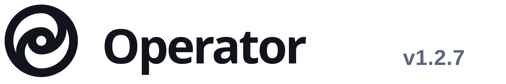
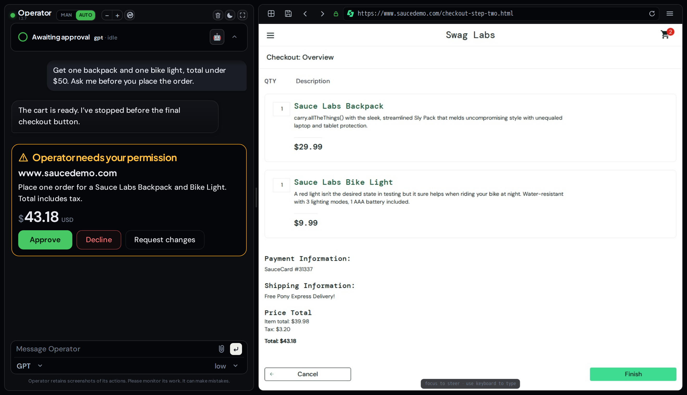
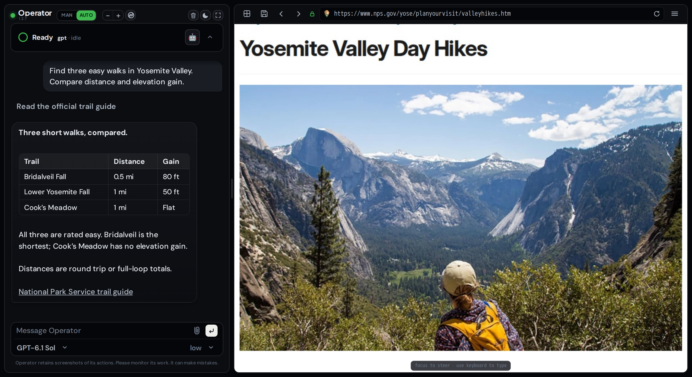
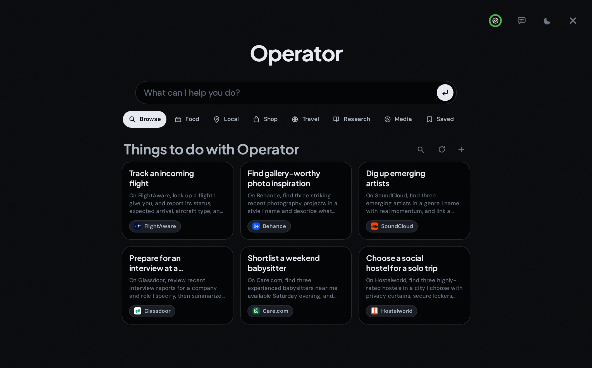
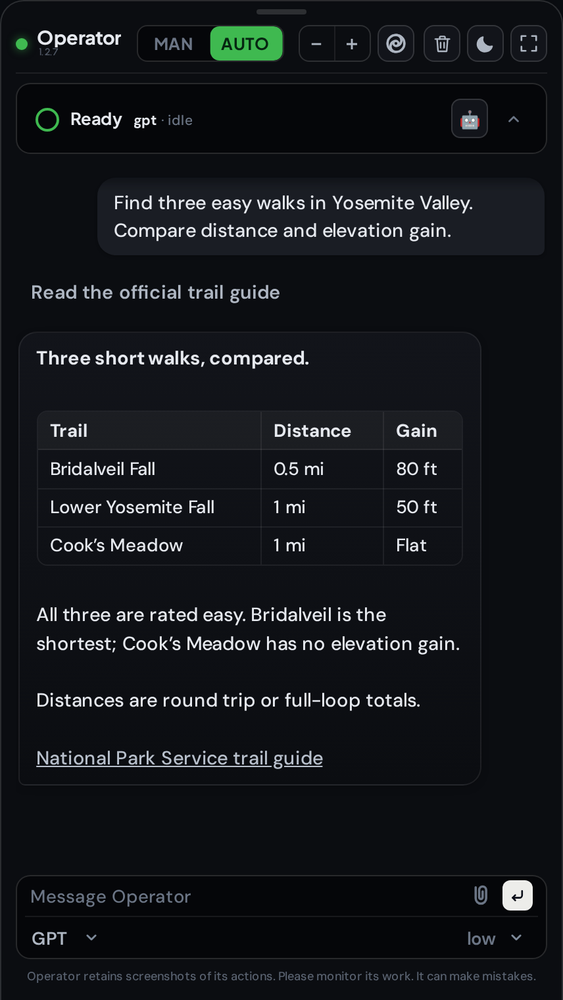
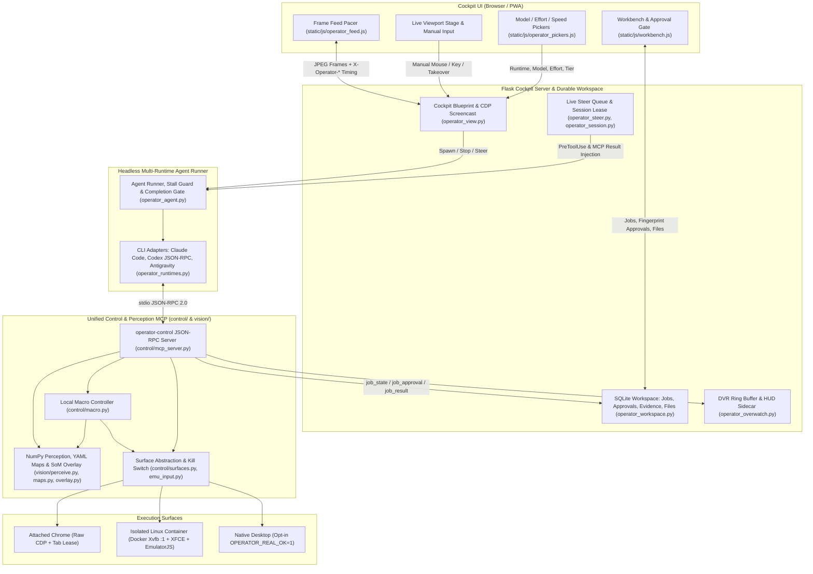

<p>
  <picture>
    <source media="(prefers-color-scheme: dark)" srcset="docs/img/operator-lockup-dark-v1.2.7.svg">
    
  </picture>
</p>

# Operator

A cockpit for browser and computer-use agents: watch the live screen, steer mid-run, and approve before anything is bought.

[](control/)
[](static/js/)
[](https://chromedevtools.github.io/devtools-protocol/)
[](https://modelcontextprotocol.io/)



Operator puts a live browser or desktop next to a headless coding agent (Claude Code, Codex or Antigravity), so a task can be handed off, watched as it happens, steered, or taken over with the mouse. Most of the work went into the ways naive screenshot-and-click loops fail: coordinates that drift on high-DPI screens, clicks that silently miss, error toasts that vanish between screenshots, and checkouts submitted without anyone looking.

## Highlights

- Macros run locally against a step and time budget with no model calls in between. Each step checks what changed and hands control back to the planner the moment a check fails or a popup appears.
- After a desktop click, a local before-and-after pixel check runs. If nothing changed, the response already carries an upscaled crop and OCR word positions, so the agent can re-aim instead of guessing.
- Screen perception needs no tokens. Template matching, colour blobs, declarative viewport maps (a chessboard's `a1..h8`, for example) and numbered Set-of-Mark overlays are all done in NumPy and Pillow.
- The browser is driven over raw CDP on its own event loop, with a timeout on every call, CSS-pixel coordinates taken from the page's layout metrics, and a stop switch checked before every input.
- `overwatch` records short frame bursts around an action and returns both the peak-change frame and the settled frame, so a toast that lasts 300 ms is still seen.
- Purchases and other irreversible actions wait for a two-step approval in the cockpit, where the agent can also be asked for changes.

## Screenshots

Purchase approval in a [demo checkout](https://www.saucedemo.com/) is shown above: Operator pauses before final submission to display the merchant, checkout URL, and exact total alongside Approve, Decline, and Request changes controls.



Desktop cockpit during a research session on the [National Park Service trail guide](https://www.nps.gov/yose/planyourvisit/valleyhikes.htm), showing the structured result card, source provenance links, and live browser viewport side by side.

<table>
  <tr>
    <td width="74%" valign="top"></td>
    <td width="26%" valign="top"></td>
  </tr>
</table>

Task launchpad with category filters and saved recipes (left), and the responsive mobile conversation sheet (right).

## Architecture



Operator splits interactive supervision, durable job state, agent orchestration, and surface control into four layers. The Flask cockpit server (`operator_view.py`) streams live frames from the active surface, manages multi-device control leases (`operator_session.py`), and persists jobs, checkpoints, evidence URLs, conversation files, and fingerprint-bound approval records in SQLite (`operator_workspace.py`). When a task starts, `operator_agent.py` launches the selected CLI coding agent (Claude Code, Codex, or Antigravity) with per-run MCP configuration, monitors the trajectory for loops or stalls, delivers mid-run user steering (`operator_steer.py`), and enforces a completion gate so runs cannot exit while an approval or required verification step is still pending. The agent interacts with the screen through `control/mcp_server.py`, which exposes local perception (`vision/`), deterministic multi-step macros (`control/macro.py`), temporal DVR burst capture (`overwatch`), and unified surface drivers (`control/surfaces.py` and `control/emu_input.py`) across Chrome CDP, an isolated Linux desktop container, and a confirm-gated native desktop.

## Inside this repository

| Module | Lines | Responsibility |
| :--- | ---: | :--- |
| [`control/mcp_server.py`](control/mcp_server.py) | 1,305 | Stdio JSON-RPC 2.0 MCP server (`operator-control`) implementing `perceive`, `game_macro`, `computer` (with step-level pixel verification and auto-crop recovery), `overwatch` (high-FPS burst capture and transient keyframe detection), `sandbox_exec`, `sandbox_window`, and `emu_input`. |
| [`static/js/workbench.js`](static/js/workbench.js) | 822 | Cockpit workbench UI rendering two-stage purchase/action approval cards, inline change-request editors, FLIP approval transitions, structured result cards with source provenance, checklist progress meters, and conversation file management. |
| [`control/surfaces.py`](control/surfaces.py) | 706 | Unified capture and input injection interface across `BrowserSurface` (raw CDP on a dedicated event-loop thread with device-to-CSS coordinate scaling), `SandboxSurface` (isolated Docker Xvfb desktop), and `RealDesktopSurface` (opt-in `OPERATOR_REAL_OK=1`), guarded by `fcntl.flock` and `operator-stop.json`. |
| [`control/macro.py`](control/macro.py) | 397 | Local macro execution engine (`MacroController`) that validates and runs multi-step action plans with local perception, `count_delta` / `pixel_change` verification, popup `watch` guards, and step/wall-clock budgets. |
| [`vision/perceive.py`](vision/perceive.py) | 317 | Pure-NumPy and Pillow visual perception pipeline: vectorized RGB-to-HSV conversion, iterative 4-connected flood-fill color blob finder, mean-absolute-difference template matcher with non-maximum suppression, and lazy `pytesseract` regional OCR. |
| [`control/emu_input.py`](control/emu_input.py) | 201 | Bounded EmulatorJS controller input and checkpoint driver over CDP, supporting frame-paced RetroPad button sequences with crash-safe release timers and 16 MiB-capped `Uint8Array` save/load slots. |
| [`static/js/operator_pickers.js`](static/js/operator_pickers.js) | 177 | Accessible WAI-ARIA `listbox` popover menu controller for model, effort, and speed selects, with 700 ms typeahead buffering, `visualViewport` auto-flip positioning, and `MutationObserver` state synchronization. |
| [`vision/maps.py`](vision/maps.py) | 173 | Declarative YAML/JSON screen-map loader and compiler that scales reference viewport regions, HSV color specs, OCR zones, and named 2D grid cells to the active frame resolution. |
| [`vision/overlay.py`](vision/overlay.py) | 92 | Grounding image overlays in pure Pillow: numbered Set-of-Mark (`#1[ref]`) bounding boxes and pill badges, labeled coordinate calibration grids, target crosshairs, and clamped full-resolution region crops. |
| [`static/js/operator_feed.js`](static/js/operator_feed.js) | 66 | Live viewport frame-delivery pacing and telemetry module enforcing per-tier byte-rate budgets, `AbortController` transfer deadlines, and clock-offset-bounded `captureToPaintMinMs` / `captureToPaintMaxMs` latency samples. |

This repository holds selected modules from a private codebase and is not runnable on its own.

## How it works

### 1. Device-to-CSS coordinate scaling on raw CDP (`control/surfaces.py`)

High-level Playwright mouse and evaluation helpers can block indefinitely when a `connect_over_cdp` session desynchronizes during navigation, and `Page.captureScreenshot` returns images in device pixels while `Input.dispatchMouseEvent` expects CSS pixels. On any display with `devicePixelRatio > 1`, clicking raw screenshot coordinates lands down and to the right of the visual target. `BrowserSurface` runs an async CDP session on a dedicated daemon thread with a hard per-operation timeout (`_OP_TIMEOUT = 6.0`) and computes the frame-to-CSS ratio from `Page.getLayoutMetrics` whenever the target page or frame dimensions change:

```python
scale_key = (id(self._page), arr.shape[1], arr.shape[0])
if getattr(self, "_scale_key", None) != scale_key:
    try:
        m = await self._send("Page.getLayoutMetrics", timeout=3.0)
        vp = m.get("cssLayoutViewport") or m.get("layoutViewport") or {}
        cw, ch = vp.get("clientWidth"), vp.get("clientHeight")
        if cw and ch:
            self._scale_x = arr.shape[1] / float(cw)
            self._scale_y = arr.shape[0] / float(ch)
            self._scale_key = scale_key
    except Exception:
        pass
return arr
```

Every subsequent `click`, `drag`, `move`, and `scroll` call passes its perceived `(x, y)` coordinates through `_to_css(x, y)` before dispatching the raw CDP input event.

### 2. Step-level pixel verification and automatic 2× crop recovery (`control/mcp_server.py`)

When an agent clicks a desktop coordinate that misses a button or hits an unfocused window, an unverified harness continues executing the rest of its plan against a stale screen state. In `OperatorMCP._tool_computer`, every consequential action captures a pre-action frame and polls `frame_change_frac` over a settle window (up to 400 ms by default, checking a `180×180` px region around clicks for at least 2% pixel change at a per-channel delta threshold of 12). If a click produces no visible change, `_look_closer` extracts a `360×360` px crop around the click point, upscales it 2× with Lanczos resampling, and runs local OCR in full-frame coordinates so the agent receives immediate visual and textual ground truth in the same tool result:

```python
def _look_closer(self, surface, coord) -> tuple:
    """(crop_ndarray | None, info dict | None) for a failed click."""
    try:
        frame = surface.frame()
        h, w = frame.shape[:2]
        half = self._LOOK_BOX
        x0, y0 = max(0, int(coord[0]) - half), max(0, int(coord[1]) - half)
        x1, y1 = min(w, int(coord[0]) + half), min(h, int(coord[1]) + half)
        if x1 - x0 < 8 or y1 - y0 < 8:
            return None, None
        crop = frame[y0:y1, x0:x1]
        img = Image.fromarray(crop).convert("RGB")
        img = img.resize((img.width * 2, img.height * 2), Image.LANCZOS)
        info: dict = {"crop_region": [x0, y0, x1 - x0, y1 - y0]}
        try:
            hits = perceive_mod.read_text(
                frame, region=(x0, y0, x1 - x0, y1 - y0))
            info["text"] = [{"text": t.text, "x": int(t.x), "y": int(t.y)}
                            for t in hits[:12]]
        except RuntimeError:
            pass   # no tesseract on the host — the crop alone still helps
        return np.asarray(img), info
    except Exception:  # noqa: BLE001 — a failed look must not break the action
        return None, None
```

### 3. Clock-offset-bounded viewport latency and bandwidth pacing (`static/js/operator_feed.js`)

Streaming a live browser or desktop viewport over variable networks requires bounding bandwidth while measuring true capture-to-paint latency without assuming the client and server clocks are synchronized. `OperatorFrameFeed.delay` paces the next frame request by taking the maximum of the target frame interval (`25 FPS` in `hi`, `15 FPS` in `lo`, `260 ms` in `eco`, `400 ms` while typing, and `900 ms` when idle) and the byte-budget recovery time (`bytes * 1000 / BYTES_PER_SECOND[tier]`). When a frame paints, `OperatorFrameFeed.presented` combines four server timestamps (`X-Operator-Request-At`, `X-Operator-Capture-Started`, `X-Operator-Capture-Finished`, `X-Operator-Response-At`) with client `performance.now()` marks to bound clock offset into `[offsetLow, offsetHigh]`:

```javascript
const h = transfer.response.headers;
const requestAt = Number(h.get('X-Operator-Request-At')) * 1000;
const responseAt = Number(h.get('X-Operator-Response-At')) * 1000;
const capturedAt = Number(h.get('X-Operator-Capture-Started')) * 1000;
const finishedAt = Number(h.get('X-Operator-Capture-Finished')) * 1000;
if (!(capturedAt > 0 && finishedAt >= capturedAt && responseAt >= finishedAt)) return null;
// The network's clock-offset uncertainty is retained as bounds, not hidden as an exact age.
const offsetLow = responseAt - transfer.headersAt;
const offsetHigh = requestAt - transfer.startedAt;
if (offsetLow > offsetHigh + 1) return null;
const sample = {captureMs: finishedAt - capturedAt, bodyMs: transfer.bodyMs,
  decodeMs: decodedAt - transfer.headersAt - transfer.bodyMs,
  paintMs: paintAt - decodedAt, bytes,
  captureToPaintMinMs: Math.max(0, paintAt - capturedAt + offsetLow),
  captureToPaintMaxMs: Math.max(0, paintAt - capturedAt + offsetHigh)};
```

## Stack

| Layer | Technologies |
| :--- | :--- |
| Backend and control harness | Python 3.12, Flask, Playwright (async Chrome DevTools Protocol), Model Context Protocol (JSON-RPC 2.0 over stdio), SQLite |
| Visual perception | NumPy, Pillow, PyYAML, Tesseract OCR (`pytesseract`) |
| Desktop and emulator surfaces | Docker, Xvfb, XFCE, `xdotool`, `scrot`, EmulatorJS (`simulateInput` over CDP) |
| Cockpit frontend | Vanilla ES2022 JavaScript, CSS custom properties, WAI-ARIA `listbox` / `dialog` primitives, HTML5 Popover, `ResizeObserver`, `MutationObserver` |

## License

The source is proprietary. This repository shows selected modules for reading; no license is granted to use, copy, modify or distribute them. Issues and pull requests are not accepted.
