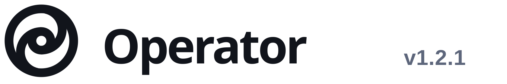
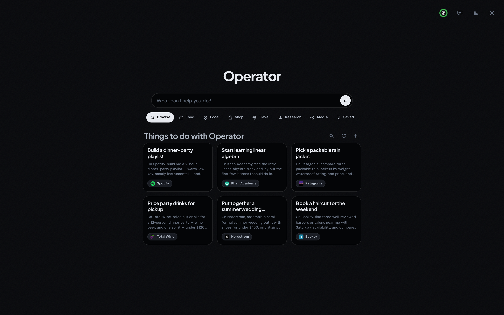

<p>
  <picture>
    <source media="(prefers-color-scheme: dark)" srcset="docs/img/operator-lockup-dark-v1.2.1.svg">
    
  </picture>
</p>

Browser / computer-use agent cockpit: give an agent (Claude, GPT or Gemini
CLI, on subscription sign-in) a task, watch the Chrome it drives, and take over
at any time. Independent project; not affiliated with OpenAI.



## Install

```bash
git clone https://github.com/jeffbai996/operator
cd operator
./start.sh        # venv, deps, browser bridge, automation Chrome, serve
```

Open `http://127.0.0.1:5005`. `start.sh` is idempotent. Sign in to your sites
once in the automation Chrome window it launches.

Manual equivalent:

```bash
python3 -m venv venv && ./venv/bin/pip install -r requirements.txt
npm ci --prefix browse
bash browse/chrome-attach.sh
./venv/bin/python app.py
```

Agent runtimes (install at least one; with none, `start.sh` reports manual mode
only):

- Claude: `claude` CLI, then `claude login` (credentials in `~/.claude`).
- GPT: `codex` CLI, then `CODEX_HOME=~/.codex-operator codex login`. Operator
  keeps its own Codex home to wire in the browser bridge.
- Gemini: Antigravity CLI (`agy`), signed in with a Google account (credentials in `~/.gemini`).

An API-key fallback exists (see `environment.example`); it costs a screenshot
per step, so prefer the CLI sign-ins.

Ships as a runnable application from the tagged source archive, not as a
Python package.

## Usage

`./start.sh` or `python app.py` serves the cockpit. `operator_view.bp` can also
be registered on another Flask app.

The default listener accepts direct loopback requests only. Browser mutations
need a matching `Origin` or `Referer` (the cockpit sends one). To bind a
network interface or sit behind a proxy or tunnel, set a token first:

```bash
export OPERATOR_AUTH_TOKEN="$(python -c 'import secrets; print(secrets.token_urlsafe(32))')"
python app.py
```

Browsers authenticate with HTTP Basic (user `operator`, the token as password);
other clients send `Authorization: Bearer <token>`. Proxied and non-loopback
requests are refused while the token is unset, and a non-loopback
`OPERATOR_HOST` refuses to start.

Surfaces: browser (default), an isolated Docker sandbox desktop, or the real
desktop (confirm-gated per session). Switch from the popover on the brand mark.

## Configuration

All optional. `environment.example` lists the variables and defaults;
`app.py` documents the server variables (`OPERATOR_HOST`, `OPERATOR_PORT`,
`OPERATOR_DEBUG`, `OPERATOR_AUTH_TOKEN`). Browser launch variables are in
`browse/chrome-attach.sh`; storage limits are in `WORKSPACE.md`. Put real
keys only in an untracked private file.

## Tests

```bash
PYTHONPATH=. python -m pytest tests/ -q
CONTROL_TEST_PYTHON=$(which python) bash control/run_tests.sh
VISION_TEST_PYTHON=$(which python) bash vision/run_tests.sh
```

Python 3.12 in CI (`.github/workflows/tests.yml`). The vision suite needs
`tesseract-ocr` and `vision/requirements.txt`. Release steps: `RELEASING.md`.

## Documentation

`CHANGELOG.md` (releases), `WORKSPACE.md` (chat files, storage, rollback),
`control/README.md`, `vision/README.md`, `computer-use/sandbox/README.md`.

## License

© 2026 Jeff Bai. All rights reserved. Source is published for reading and
reference; no license is granted to use, copy, modify, or distribute it. Issues
and pull requests are not accepted.
