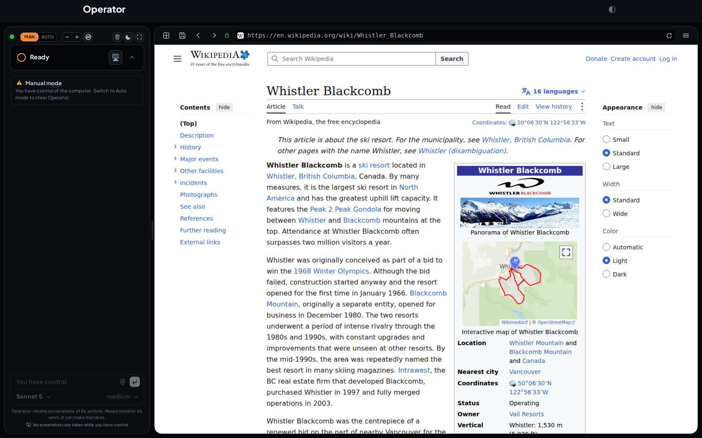
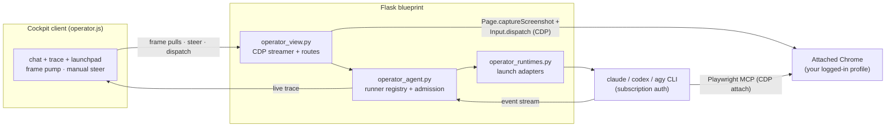

<p>
  <picture>
    <source media="(prefers-color-scheme: dark)" srcset="docs/img/operator-lockup-dark-v1.2.1.svg">
    
  </picture>
</p>
<p><b>General-purpose computer using agent</b></p>

<p>
  
  
  
  
  
  
</p>

<p>
  
</p>

<p><sub><i>The launchpad is the one place to find and manage cloud chats: search by title or prompt, see the bot, surface, and live state, then resume, rename, or safely remove a thread. Each conversation owns its runner, transcript, resumed model session, work directory, state, and browser tab. Concurrent agents share cookies and extensions without being able to see, select, navigate, or close each other's tabs.</i></sub></p>

---

A live **browser / computer-use agent cockpit**. Give it a task, watch the exact
Chrome it is driving, take the wheel whenever you want, and keep separate jobs
alive in separate conversations. Threads synchronize across devices with an
explicit watch/take-over lease, while per-conversation tab ownership lets
multiple agents safely use the same signed-in browser. A responsive Chats
library lives on the launchpad instead of consuming the browser brow. Claude,
GPT, and Gemini runtimes use their normal subscription sign-ins rather than
metered screenshot-heavy API calls.

> **Inspired by OpenAI's Operator.** This project borrows the name and the spirit of a watch-the-agent-drive interface. It is an independent implementation, not affiliated with, endorsed by OpenAI, or derived from any OpenAI products.

---

## Quickstart

```bash
git clone https://github.com/jeffbai996/operator
cd operator
./start.sh                    # → open http://127.0.0.1:5005
```

One script does everything: venv + deps, launches the automation Chrome
(sign into your sites in that window, once), reports which agent runtimes and
surfaces it found, and serves the cockpit. Idempotent — re-run it any time.
No required config; `environment.example` documents the optional knobs without
using a filename that could be mistaken for a safe place to commit secrets.

<details>
<summary>Manual steps (what start.sh does)</summary>

```bash
python3 -m venv venv && ./venv/bin/pip install -r requirements.txt
npm ci --prefix browse        # the Playwright MCP bridge agents drive the browser through
bash browse/chrome-attach.sh  # the browser the agent drives (logged-in, separate profile)
./venv/bin/python app.py      # open http://127.0.0.1:5005
```
</details>

**Agent runtime — bring your own subscription** (no metered API key, the cheap path):
- **Claude** — install the `claude` CLI and `claude login` (creds in `~/.claude`)
- **GPT** — install the `codex` CLI and sign in with `CODEX_HOME=~/.codex-operator codex login`; Operator keeps its own Codex home so it can wire in the browser bridge
- **Gemini** — install the Antigravity CLI (`agy`) and sign in with a Google account (creds in `~/.gemini`)

Operator detects whichever you have and drives the browser with it. An API-key
fallback is documented in `environment.example`, but driving a browser over the API is
expensive (a screenshot per step) — the logged-in CLI path is strongly preferred.

> **Status:** **v1.2.1** — the cockpit streams the tab the agent is actually
> driving: reopening lands on the live run's own tab, and a same-URL workload
> can no longer pin the view on the wrong one. 1.2 added durable jobs with
> checkpoints and evidence-linked result cards, native in-flight steering,
> chat files and owned-browser downloads, recipe authorization limits, and
> bounded diagnostics.

## What a session looks like

<p>
  
</p>

<p><sub><i>The same live thread opened on a second device. It adopts the current
server revision and enters observer mode instead of racing the controller's
writes. <b>Take over</b> moves the short editing lease deliberately; if the first
device disappears, the lease expires on its own.</i></sub></p>

## Distribution

Operator ships as a runnable application, not a Python library. Use the tagged
source archive and `./start.sh`; a PyPI wheel would omit or awkwardly relocate
the browser launcher, templates, static assets, and desktop-control helpers that
must stay together, without making installation meaningfully easier.

## Things worth trying

- **Plan against live inventory:** “Compare nonstop weekend flights from Seattle
  to San Francisco next month, keep the best three, and explain the trade-off.”
- **Research across sources:** “Read the official mission page and its latest
  news coverage, reconcile any disagreement, and give me a five-bullet brief.”
- **Work a logged-in tool:** “Open my project dashboard, find everything blocked
  this week, and draft a cleanup order. Do not submit changes.”
- **Make a file in the sandbox:** “Build a one-page spreadsheet from these notes,
  format it cleanly, and leave the finished file in Downloads.”
- **Stay in the loop:** send a follow-up while the agent is working, switch to a
  second conversation, or take over with MAN mode without losing the trace.

## What it does

| | |
|---|---|
| **Live view** | Self-clocking frame pump of an attached Chrome via CDP `Page.captureScreenshot` — latency bounded at ~1 frame in flight on any device, with an adaptive `lo` tier (downscale + harder JPEG) for small screens and Save-Data connections. |
| **Manual steer** | Click / type / scroll / press-hold / drag flow straight through to the page. |
| **Agent drive** | Claude Code, Codex and Antigravity (`agy`) runtimes on subscription auth — no metered API keys. Each conversation owns its transcript, resumed runtime sessions, work directory, state file, stop/steer channel, and browser-tab lease. |
| **Trace** | Interleaved thinking + actions; commands and URLs render as code blocks, element targets as plain text; per-turn step counts; modern error blocks that surface the failure reason. Agent answers render as real markdown — pipe tables included — and ASCII/box-drawing fences scroll sideways instead of wrapping to soup. |
| **UX** | MAN/AUTO modes, a launchpad-only Chats library with search/previews/rename/guarded delete, observer/take-over state, drag-to-resize chat, live font controls, mobile/PWA layout, saved tasks, `/` palette, history replay, and a real scheduler (repeat/time/day → cron). |
| **Reliability** | Revisioned server-authoritative threads with optimistic writes; conversation-scoped state machines behind a shared global cap and one-slot-per-runtime guard; tab-filtered Playwright contexts on one shared Chrome; deterministic Stop/timeout/token-cap outcomes; browser preflight that refuses invisible work; hardened stream parsing; first-paint/re-entry viewport repair; deployment admission draining; and persisted scheduler dedupe. |
| **Surfaces** | Browser (default), an isolated sandbox desktop (Xvfb), or the real desktop (gated — explicit per-session confirm, panic-STOP always on screen). Switch from a popover on the brand mark; the live feed follows. |
| **Perception** | Zero-token local vision (`vision/`): template/colour-blob target finding + OCR, per-game region maps, and grid/crop grounding overlays — the agent reads labeled targets instead of squinting at raw pixels. |
| **game_macro** | A planner/controller split (`control/`): the model emits a multi-step macro once, a local controller executes + verifies it at machine speed with zero mid-macro model calls, and only reports back on completion or surprise. |

---

## Layout

```text
operator_view.py          blueprint: streamer (CDP screenshots) + /operator routes
operator_agent.py         AgentRunner + conversation registry + admission cap
operator_runtimes.py      per-runtime launch adapters (argv + MCP-config ownership)
operator_prompts.py       personas, surface mandates, the task SYSTEM DIRECTIVEs
operator_trace.py         pure tool-event -> trace-label functions + text cleaning
operator_agy.py           Gemini/Antigravity trajectory parser (no event stream)
operator_tasks.py         saved-task store (name / prompt / bot / model / tools)
operator_schedule.py      cron matcher + background dispatcher, disk-persisted dedupe
operator_session.py       conversation map (rev-counted, cross-device)
operator_history.py       flight recorder: SQLite run ledger, one row per finished run
operator_steer.py         mid-run steer queue (cross-process, hook + exit-seam delivery)
operator_restart_guard.py deployment admission lock + active-run drain helper
steer_hook.py             PostToolUse hook: injects queued steers into the live agent
templates/operator.html   the UI markup + a small endpoint-config script
static/js/operator.js     the entire cockpit client (extracted from the template)
static/operator.css       the UI stylesheet (extracted from the template)
align_audit.py            dev tool: measures header / urlbar alignment
vision/                   local perception: template/colour targets, OCR, per-game maps
control/                  surface interface + game_macro controller + control MCP
computer-use/             sandbox (Xvfb) + real-desktop (PowerShell/WSL) backends
browse/operator_browser_tabs.py  locked conversation → Chrome target registry
browse/operator_playwright_mcp.js Playwright context filtered to owned tabs/popups
```

---

## How it's wired



One Chrome, two drivers: the streamer screenshots and steers it over CDP for the
human, while the selected agent runtime attaches to the *same* browser through a
Playwright MCP. A locked registry reserves one target per conversation, and an
owned-context facade exposes only that target plus tabs or popups descended from
it. Cookies and extensions remain shared; tab control does not. Dispatch is
refused if the browser is unavailable, so an agent cannot quietly work in an
invisible fallback. Shared admission keeps total load and per-runtime collisions
bounded. The trace is the same event stream the runner consumed.

---

## Run

Standalone: `./start.sh` (or `python app.py`) serves the cockpit at `http://127.0.0.1:5005`. It also still works as a Flask blueprint — register `operator_view.bp` on any host app and serve it behind a reverse proxy / tunnel.

The zero-config standalone listener accepts only direct loopback requests.
Browser mutations also require a matching `Origin` or `Referer`, which the
cockpit sends automatically. To bind to a network interface or put the
standalone app behind a reverse proxy/tunnel, configure a strong token first:

```bash
export OPERATOR_AUTH_TOKEN="$(python -c 'import secrets; print(secrets.token_urlsafe(32))')"
python app.py
```

The browser uses HTTP Basic authentication with username `operator` and the
token as its password. Non-browser clients may send
`Authorization: Bearer <token>`. Proxied and non-loopback requests fail closed
when the token is unset, and a non-loopback `OPERATOR_HOST` refuses to start.

---

## Tests

The CI workflow (`.github/workflows/tests.yml`) runs three suites with Python 3.12:

```bash
PYTHONPATH=. python -m pytest tests/ -q
CONTROL_TEST_PYTHON=$(which python) bash control/run_tests.sh
VISION_TEST_PYTHON=$(which python) bash vision/run_tests.sh
```

The vision suite needs `tesseract-ocr` installed and `vision/requirements.txt`.

---

## Roadmap

**v1.1 — shipped: cross-device threads + shared-browser tab isolation**
- Server-authoritative conversation revisions, observer mode, and explicit takeover.
- One stable tab lease per conversation inside the same logged-in browser profile.
- Concurrent agents cannot enumerate, select, navigate, or close one another's tabs.
- Calm nonfatal recovery notices; real runtime failures remain red.

**Planned: perception depth + the canvas-game showcase** (the v1.2 releases shipped jobs, results, files and steering instead; this work is still open)
- Self-hosted OpenRSC demo (zero ToS risk) — the flagship RuneScape-class canvas run.
- Sprite-capture workflow: lift template sprites from live frames into `vision/maps/`.
- Map auto-calibration: derive region geometry from perception (blob grids) instead of static seed coordinates, so maps survive layout/viewport changes.
- Desktop + macro combined: `game_macro` on the sandbox desktop — grind a native app the way a canvas game is ground.
- OCR in anger: system tesseract, text conditions and chat/tooltip reading in real macros.

**Planned: continuity**
- Long-lived controller sessions: controller state and watchers persist across `game_macro` calls; events push to the planner instead of being polled.
- Auto-replan loop: on a macro yield the planner re-decides and continues under a hard step/token budget — sustained autonomous play sessions.
- ~~Driver parity~~ — shipped early, in v1.0.1.

**Explicitly not planned**: twitch-reflex games (physics, not skill — a different control layer), and the real desktop as a default anything — it stays confirm-gated with STOP on screen.

## v1.2.1 — the tab you watch is the tab being driven

On attach the
streamer prefers the live run's registered tab, then the browser's real front
tab unless it is an empty New Tab, then the newest page with content; creation
order is never the tie-break. While a run is live the view follows the
conversation's owned tab from the tab registry instead of re-asserting its own
guess, so one SPA page for the whole task can no longer hold the view on the
wrong tab. Every page switch is written to the viewport flight recorder, which
now keeps 240 events. Tab titles use the chat face. Also carried under this
number: steering that no longer loses the run it interrupted, durable chat
delete and chat metadata, result cards anchored to their producing turn,
composer drafts that survive refresh, owned-tab reaping with ownership guards,
a 1Password popup the owner opened is left alone, per-run isolation of sandbox
transport, downloads and Gemini MCP config, and Gemini Flash 3.8.

The polish pass under the same label: one table-tested decision picks the
streamed tab (dead-current, owned, mover, front, new-tab) and a count change
mid-run is no longer a reason to switch. Delegation chats carry an origin,
stay out of the Chats library unless the Delegations filter is chosen, never
become the human's draft, and are pruned after a week untouched. On a
brand-new cockpit the trash button works again: a fresh delete of the
implicit conversation is idempotent. The idle-tab reaper's websocket
dependency is declared, so it can close a tab. The mirror proves this public
cut collects before it ships.

## Changelog

Release history is in [CHANGELOG.md](CHANGELOG.md).

## License

© 2026 Jeff Bai. All rights reserved.

Source is published for reading and reference. No license is granted to use,
copy, modify, or distribute this software. Not accepting issues or pull requests.
